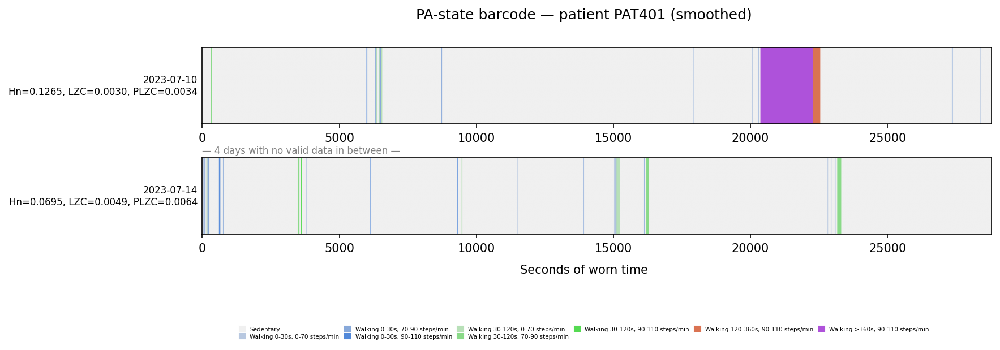

:html_theme.sidebar_secondary.remove: true

Complexity metrics
==================

Compute the complexity of the daily physical-activity (PA) pattern from
walking-bout-level data: the day is encoded as a 1 Hz sequence of **PA states**
(the "barcode" of Paraschiv-Ionescu et al. 2012), and its temporal structure is
summarized with a set of complexity measures. Conventional DMOs quantify *how
much* a person moves; these metrics quantify *how* that movement is temporally
organized.

Four metrics are computed, all in
:class:`~dmos_pipeline.complexity_analyzer.PAComplexity_analyzer`: normalized
Shannon entropy (**Hn**), Lempel-Ziv complexity (**LZC**) and permutation
Lempel-Ziv complexity (**PLZC**) are computed **per day** and then aggregated
over the week; sample entropy (**SampEn**) is computed only at the **week**
level, on the concatenated valid days.

The full script is ``examples/main_complexity.py``.

1. Inputs
---------

The complexity analysis does not re-process raw signals: it starts from the
**WB-level file** already produced by the walking-bout analysis. You point it at
the patient folder and name the input file.

.. code-block:: python

   from pathlib import Path
   import pandas as pd
   from dmos_pipeline import Collector, PAComplexity_analyzer

   patient_id = "PAT401"

   # project_folder = where the per-patient data lives (one sub-folder per patient)
   project_folder = Path(r"C:\path\to\project_folder")
   patient_directory = project_folder / patient_id

   # the required input: the WB-level table with a PA_state column
   input_folder = patient_directory / "outputs_"
   wb_parameters_average_path = (
       input_folder / f"{patient_id}_multiple_dates_wb_parameters_average.csv"
   )
   output_folder = patient_directory / "outputs_"

What it needs:

- ``wb_parameters_average_path`` — the **walking-bout-level table** from
  :class:`~dmos_pipeline.wb_analyzer.WalkingBouts_analyzer`, with at least
  ``patient_id``, ``recording_date``, ``session_id``, ``WB_id``, ``start``,
  ``end`` and, crucially, a **``PA_state``** column (assigned upstream with
  ``add_pa_state_to_wb_dataframe``). This is the only file you supply.
- the **logs** collected by :class:`~dmos_pipeline.csv_collector.Collector`,
  which provide wearing time and non-wearing windows needed to keep only worn
  seconds.

**Example input** (first rows of ``wb_parameters_average`` for patient PAT401 —
illustrative values; ``start``/``end`` are in raw samples, ``PA_state`` is a
walking state):

.. list-table::
   :header-rows: 1
   :widths: 22 16 12 16 16 14

   * - recording_date
     - session_id
     - WB_id
     - start
     - end
     - PA_state
   * - 2023-07-10
     - week_1
     - 0
     - 32370
     - 36499
     - 13
   * - 2023-07-10
     - week_1
     - 1
     - 247571
     - 248533
     - 8
   * - 2023-07-10
     - week_1
     - 2
     - 252571
     - 253675
     - 8

2. Parameters choice
--------------------

.. code-block:: python

   window_seconds = 30
   k_folds = 10
   pa_state_choice = "modified"
   apply_time_window = True
   window_hours = 8
   min_wearing_time_hours = 8.0
   random_state = 0
   aggregation = "mean"
   selected_dates = None

What each option does:

``window_seconds = 30``
   Length of the smoothing window. Very short bouts are plausibly sensor noise
   rather than real behaviour; 30 s is the shortest walking-duration bin of the
   barcode, below which a state change is not treated as a meaningful activity
   bout (Zhang et al. 2018).
``k_folds = 10``
   Number of random-shift folds in the majority-vote smoothing.
``pa_state_choice = "modified"``
   Tells the analyzer which PA-state scheme was used upstream (in
   ``add_pa_state_to_wb_dataframe``) to assign the ``PA_state`` column, and must
   match it; it sets the alphabet size used to normalize Hn and LZC. Barcodes in
   the literature use **18 states** (``"traditional"``, Paraschiv-Ionescu et al.
   2012) or **25 states** (``"modified"``, Paraschiv-Ionescu & Büla 2018); here
   the non-walking states are collapsed into a single sedentary state.
``apply_time_window = True`` / ``window_hours = 8``
   Cap each day to the first **8 h** of worn time, so every analyzed day has a
   full-length sequence and days are comparable. Paraschiv-Ionescu et al. 2012
   record 8 h/day. Set ``apply_time_window=False`` to use all worn time instead.
``min_wearing_time_hours = 8.0``
   Days with less worn time are skipped. This 8 h threshold is our own choice
   and depends on the implementation design and the purpose of the analysis;
   ``None`` disables the filter.
``random_state = 0``
   Seeds the smoothing so the result is reproducible; a separate generator is
   derived per patient and date, so a day's smoothed result does not depend on
   which other days are analyzed with it.
``aggregation = "mean"``
   How the weekly summary combines the daily Hn/LZC/PLZC — ``"mean"`` or
   ``"median"`` over the valid days.
``selected_dates``
   Restrict the analysis to specific recording dates — a list such as
   ``["2023-07-10", "2023-07-14", "2023-07-17"]`` — or leave it ``None`` to use
   every date present in the file.

3. Load the WB-level input
--------------------------

.. code-block:: python

   wb_parameters_average = pd.read_csv(wb_parameters_average_path)

   # the PA states must already be in the file
   if "PA_state" not in wb_parameters_average.columns:
       raise KeyError(
           "Column 'PA_state' is missing: assign PA states upstream with "
           "add_pa_state_to_wb_dataframe(pa_state_choice) in the WB analysis."
       )

   # keep only the chosen dates, if any were specified
   if selected_dates is not None:
       wb_parameters_average = wb_parameters_average[
           wb_parameters_average["recording_date"].astype(str).isin(selected_dates)
       ]

   available_dates = sorted(
       wb_parameters_average["recording_date"].dropna().astype(str).unique()
   )

The two guards:

- **PA-state check** — stops if the ``PA_state`` column is not in the file. The
  states must have been assigned upstream with ``add_pa_state_to_wb_dataframe``,
  using the **same scheme** as ``pa_state_choice`` (``"modified"`` or
  ``"traditional"``); the two must be consistent, otherwise the alphabet size
  used for Hn and LZC would not match the states in the data.
- **date filter** — ``selected_dates is not None`` means "only filter if the
  user actually provided a list of dates": if ``selected_dates`` is a list, keep
  only those recording dates; if it is ``None``, keep all of them.
  ``available_dates`` is then the sorted list of dates that will be analyzed.

4. Collect the logs
-------------------

.. code-block:: python

   collector = Collector(
       patient_id=patient_id,
       date=available_dates,
       patient_directory=patient_directory,
   )
   collector.collect()
   log = collector.log

:class:`~dmos_pipeline.csv_collector.Collector` gathers, for each recording
date, the session logs that carry the **wearing start**, **non-wearing
windows** and **wearing time**. These let the analyzer keep only worn seconds
when building the 1 Hz series (non-worn seconds are removed, not filled with the
sedentary state, which would bias every metric toward the sedentary pattern).

5. Day-level complexity metrics (Hn, LZC, PLZC)
-----------------------------------------------

.. code-block:: python

   analyzer = PAComplexity_analyzer(
       wb_parameters_average=wb_parameters_average,
       log=log,
       window_seconds=window_seconds,
       k_folds=k_folds,
       pa_state_choice=pa_state_choice,
       apply_time_window=apply_time_window,
       window_hours=window_hours,
       min_wearing_time_hours=min_wearing_time_hours,
       random_state=random_state,
   )
   analyzer.run()
   complexity = analyzer.complexity_df

   saved_daily_path = analyzer.save_complexity(
       output_folder=output_folder,
       filename=f"{patient_id}_complexity_metrics.csv",
   )
   print(f"valid days: {len(complexity)}  |  PLZC lag used: {analyzer.plzc_lag_} s")

``run()`` builds the 1 Hz PA-state series over worn time, smooths it with the
K-fold / 30 s majority vote, and computes the daily metrics on the smoothed
series. ``save_complexity`` then writes ``complexity_df`` to a CSV — **one row
per valid day**, with ``recording_date``, ``session_id``, ``n_seconds`` and the
``Hn``, ``LZC``, ``PLZC`` columns.

The three daily metrics, as defined in the source papers:

Hn — normalized Shannon entropy
   A *structural-static* measure (Paraschiv-Ionescu et al. 2012): it quantifies
   the diversity and evenness of the states and is explicitly insensitive to
   their temporal order. Normalized by ``log2(alpha)``, with ``alpha`` the
   number of *possible* states, so ``Hn ∈ [0, 1]``.
LZC — Lempel-Ziv complexity
   A *structural-dynamic, non-parametric* measure (Paraschiv-Ionescu et al.
   2012): it captures the rate at which new sub-patterns of increasing length
   appear as the sequence unfolds, and is conceptually linked to Kolmogorov
   complexity (Kaspar-Schuster counting).
PLZC — permutation Lempel-Ziv complexity
   More robust to signal artifacts than plain LZC, because it uses only the
   ordinal (rank) relations between consecutive values rather than their
   absolute values (Backes et al. 2022); defined by Bai et al. 2015. Its
   embedding lag is selected automatically from the data (not a user setting).

Running this on PAT401 analyzes three recording dates; one is dropped by the
wearing-time filter::

   DATES: ['2023-07-10', '2023-07-14', '2023-07-17']
   [!] PAT401 2023-07-17: wearing time 3.2 h < 8.0 h, day skipped
   [i] PLZC: lag = 500 s (from the mean autocorrelation of 2 day(s))
   valid days: 2  |  PLZC lag used: 500 s

**Day-level output** (``PAT401_complexity_metrics.csv`` — illustrative values):

.. list-table::
   :header-rows: 1
   :widths: 24 16 16 20 20

   * - recording_date
     - n_seconds
     - Hn
     - LZC
     - PLZC
   * - 2023-07-10
     - 28800
     - 0.126
     - 0.0030
     - 0.0034
   * - 2023-07-14
     - 28800
     - 0.070
     - 0.0049
     - 0.0064

The very low values are expected: PAT401's days are dominated by the sedentary
state, so the PA-state sequence is highly regular (low entropy and complexity).

6. Week-level aggregation (and SampEn)
--------------------------------------

.. code-block:: python

   weekly = analyzer.weekly_summary(
       period_col="session_id",
       aggregation=aggregation,
   )
   weekly.to_csv(output_folder / f"{patient_id}_complexity_weekly.csv", index=False)

``weekly_summary`` is a method of the analyzer, called after ``run()``. It
combines two conventions:

- **Aggregated daily metrics** — ``Hn_mean``, ``LZC_mean``, ``PLZC_mean`` (or
  ``*_median``): the daily values aggregated over the valid days of the period,
  following Zhang et al. 2018 (per-day then averaged over the week).
- **SampEn** — sample entropy with ``m = 3``, ``r = 1`` (Paraschiv-Ionescu et
  al. 2012, Eq. 1): the negative natural log of the conditional probability that
  two sub-patterns similar for ``m`` points (within tolerance ``r``) remain
  similar at ``m+1`` points. It is computed **once** on the smoothed series of
  all valid days concatenated in chronological order, *not* per day. SampEn is
  "very susceptible to resting periods" (Backes et al. 2022), so low values are
  expected on sedentary-dominated free-living data.

**Week-level output** (``PAT401_complexity_weekly.csv`` — illustrative values):

.. list-table::
   :header-rows: 1
   :widths: 16 14 16 16 16 16

   * - session_id
     - n_valid_days
     - Hn_mean
     - LZC_mean
     - PLZC_mean
     - SampEn
   * - week_1
     - 2
     - 0.098
     - 0.0040
     - 0.0049
     - 0.0011

7. Barcode figure
-----------------

.. code-block:: python

   analyzer.plot_barcode(
       patient_id, use_smoothed=True,
       output_path=output_folder / f"{patient_id}_barcode.png", show=False,
   )

The **barcode** is the 1 Hz PA-state sequence introduced by Paraschiv-Ionescu et
al. 2012 to represent a day of physical activity as a coloured symbolic strip.

What the figure shows:

- Each **row** is one valid day (8 h of worn time, one colour per second),
  labelled with that day's Hn, LZC and PLZC.
- The **colours** are the PA states (see the legend): each coloured band is a
  walking bout, coloured by its duration × cadence class.
- The large **light-grey areas** are the *sedentary* state — seconds with no
  walking bout.

   PA-state barcode of patient PAT401's two valid days (illustrative). The title
   says *smoothed* because the sequence shown is the one after the 30 s
   majority-vote smoothing — exactly what the metrics are computed on (pass
   ``use_smoothed=False`` for the sequence before smoothing). The light-grey
   sedentary state dominates both days, which is why the complexity values are so
   low.

References
----------

- Prigent, G. et al. (2024). Effects of multidisciplinary inpatient rehabilitation on everyday life physical activity and gait in patients with multiple sclerosis. *Journal of NeuroEngineering and Rehabilitation*, 21:88.
- Paraschiv-Ionescu, A., Perruchoud, C., Buchser, E., Aminian, K. (2012). Barcoding human physical activity to assess chronic pain conditions. *PLoS ONE*, 7(2):e32239.
- Paraschiv-Ionescu, A., Büla, C.J., Major, K., Lenoble-Hoskovec, C., Krief, H., El-Moufawad, C., Aminian, K. (2018). Concern about falling and complexity of free-living physical activity patterns in well-functioning older adults. *Gerontology*, 64(6):603-611.
- Zhang, W. et al. (2018). Complexity of daily physical activity is more sensitive than conventional metrics to assess functional change in younger older adults. *Sensors*, 18(7):2032.
- Backes, A., Gupta, T., Schmitz, S., Fagherazzi, G., van Hees, V., Malisoux, L. (2022). Advanced analytical methods to assess physical activity behavior using accelerometer time series: a scoping review. *Scandinavian Journal of Medicine & Science in Sports*, 32(1):18-44.
- Bai, Y., Liang, Z., Li, X. (2015). A permutation Lempel-Ziv complexity measure for EEG analysis. *Biomedical Signal Processing and Control*, 19:102-114.
